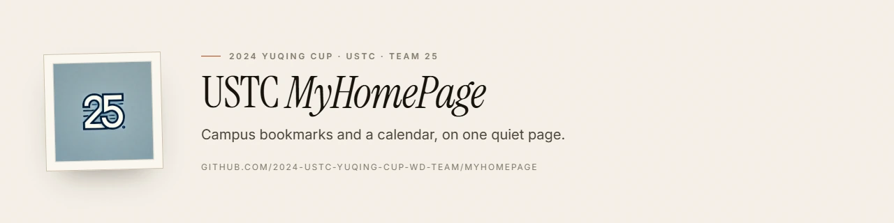
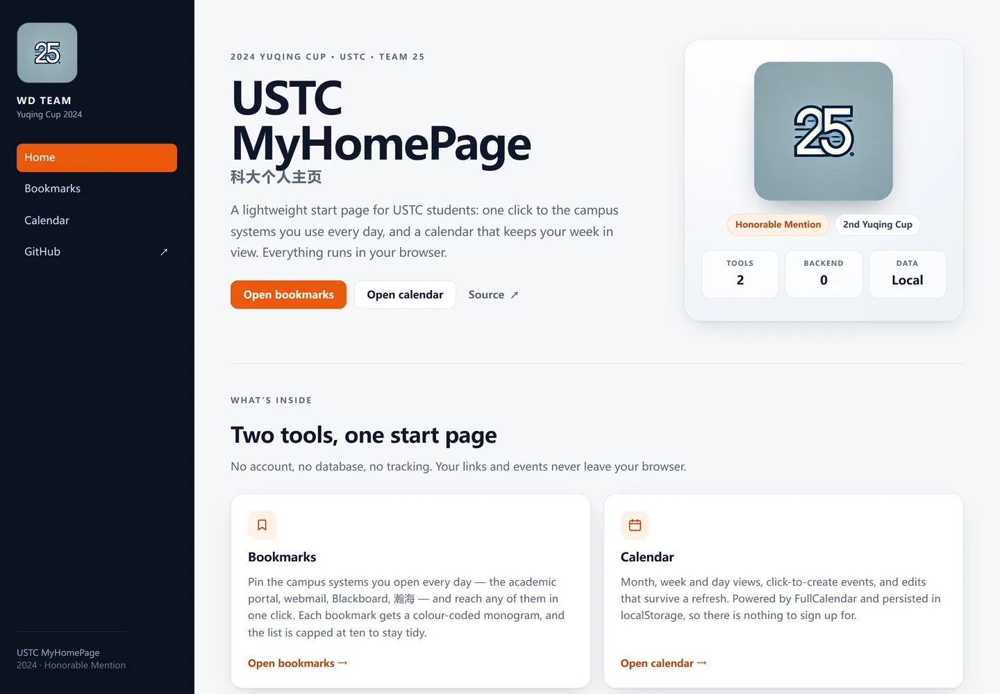
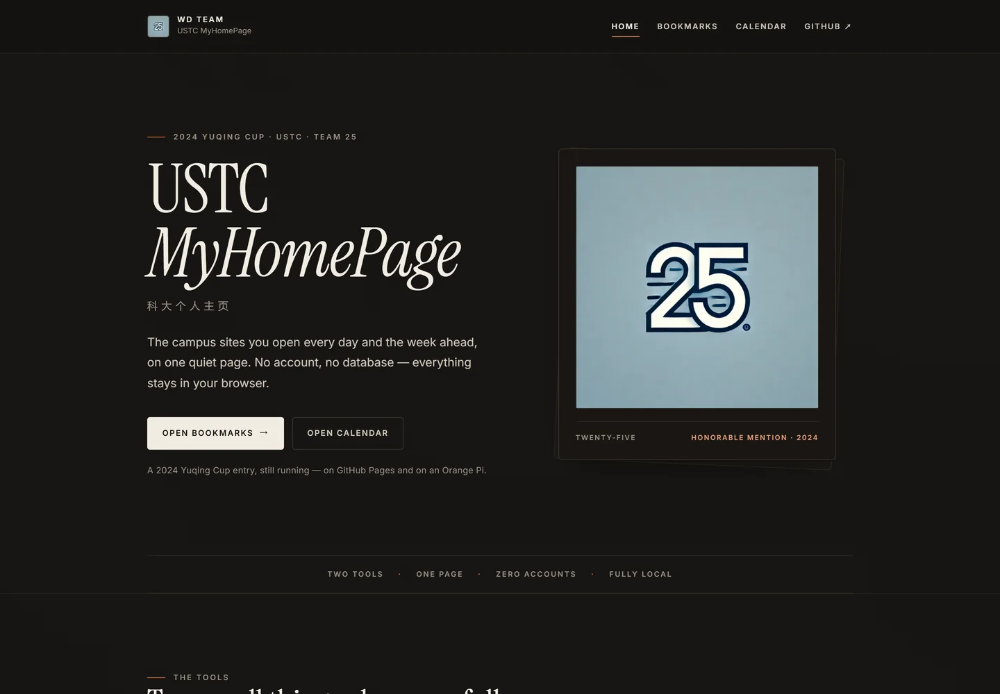
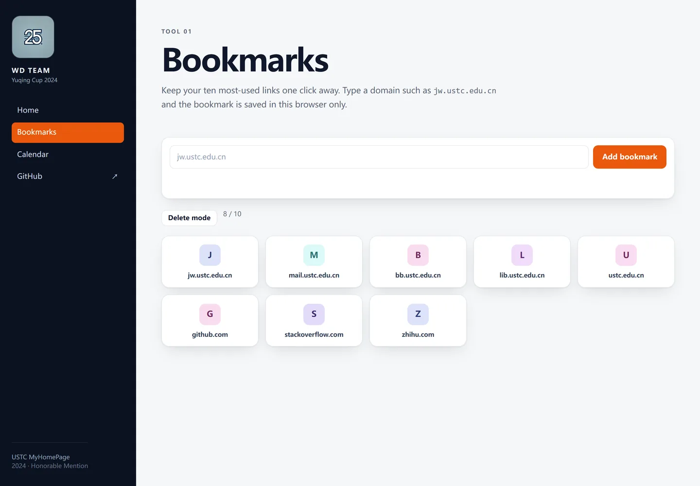
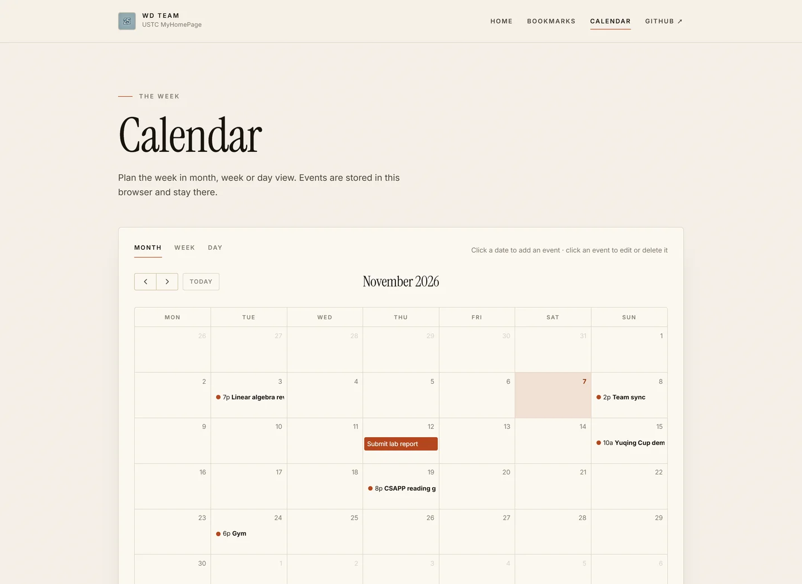

<div align="center">



# USTC MyHomePage

A lightweight start page for USTC students: **campus bookmarks** and a **personal calendar**, in one static site.
Built by **WD Team** for the 2024 USTC Yuqing Cup.

[](https://2024-ustc-yuqing-cup-wd-team.github.io/myhomepage/)
[](https://github.com/2024-ustc-yuqing-cup-wd-team/myhomepage/actions/workflows/ci.yml)
[](LICENSE)
[](LICENSE-docs)
[](#status)

[Live demo](https://2024-ustc-yuqing-cup-wd-team.github.io/myhomepage/) ·
[中文说明](README.zh-CN.md) ·
[Documentation](docs/) ·
[Deployment](https://github.com/2024-ustc-yuqing-cup-wd-team/orangepi-server)

</div>

## Overview

Students at USTC juggle the academic portal, webmail, Blackboard, the 瀚海
teaching platform, the library and a handful of other sites every day. This
project collects the ones you use most into a single start page, and adds a
calendar so the week is visible in the same place.

Everything is local-first: there is no account, no database and no analytics.
Bookmarks and events are kept in `localStorage`, and the site makes **zero
third-party requests** at runtime — which also means it works on an offline
campus LAN.

The interface is deliberately quiet: an editorial layout set in self-hosted
**Instrument Serif** and **Inter**, warm paper tones, one terracotta accent, and
a light or dark theme that follows the system preference.

| Home — light | Home — dark |
| --- | --- |
|  |  |

| Bookmarks | Calendar |
| --- | --- |
|  |  |

## Features

- **Bookmarks** — pin up to ten sites, each with a colour-coded monogram (no
  favicon service, no tracking), and open them in a new tab.
- **Calendar** — month, week and day views powered by FullCalendar, with
  click-to-create events, edit and delete, and persistence in `localStorage`.
- **Static and self-hostable** — no build step, no runtime dependency on a
  back end. Drop the folder on Nginx, GitHub Pages, or anything that can serve
  files.
- **Optional API** — a tiny Express service with `GET /api/health` is available
  in the deployment repository for the Orange Pi setup.
- **Light and dark** — the palette follows `prefers-color-scheme`; no toggle or
  flash of the wrong theme.
- **Self-hosted type** — Instrument Serif and Inter ship as WOFF2 files with
  their OFL licences, so the typography also works offline.
- **Accessible by default** — semantic landmarks, visible focus states, a skip
  link, keyboard-operable dialogs and `prefers-reduced-motion` support.

## Tech stack

| Layer | Choice |
| --- | --- |
| Markup / styling | HTML5, hand-written CSS (no framework) |
| Typography | Instrument Serif + Inter (self-hosted, SIL OFL) |
| Behaviour | Vanilla JavaScript (ES2017, no bundler) |
| Calendar | [FullCalendar 6](https://fullcalendar.io/) (vendored, MIT) |
| Hosting | GitHub Pages, or Nginx on an Orange Pi |
| Optional API | Node.js + Express |
| Storage | `localStorage` |

## Project structure

```text
myhomepage/
├── index.html            # landing page
├── bookmarks.html        # bookmark manager
├── calendar.html         # calendar
├── 404.html              # GitHub Pages 404
├── assets/
│   ├── css/              # base.css, bookmarks.css, calendar.css
│   ├── js/               # bookmarks.js, calendar.js
│   ├── img/              # logo, favicon, banner, screenshots
│   ├── fonts/            # Instrument Serif + Inter (WOFF2, OFL)
│   └── vendor/fullcalendar/
├── docs/
│   ├── requirements.md   # 2024 requirements analysis
│   ├── design.md         # 2024 design + post-competition refactor notes
│   └── archive/          # original Chinese PDFs
├── scripts/check.mjs     # dependency-free HTML / link / JS checks
├── .github/              # issue templates and CI
├── LICENSE               # MIT (code)
└── LICENSE-docs          # CC BY 4.0 (documentation)
```

## Run locally

No installation and no build step:

```bash
git clone https://github.com/2024-ustc-yuqing-cup-wd-team/myhomepage.git
cd myhomepage
python3 -m http.server 8000
# open http://localhost:8000
```

Any static server works (`npx serve`, `php -S`, Nginx, …). Opening
`index.html` directly from the file system also works in most browsers, though
a local server is recommended.

### Checks

```bash
node scripts/check.mjs
```

The script validates HTML structure, local links, anchors, JavaScript syntax
and markdown links, and runs in CI on every push.

## Deploy

### GitHub Pages

The repository is published from the `main` branch root:

<https://2024-ustc-yuqing-cup-wd-team.github.io/myhomepage/>

### Self-hosted on an Orange Pi

The companion repository
[`orangepi-server`](https://github.com/2024-ustc-yuqing-cup-wd-team/orangepi-server)
contains the Nginx configuration, a systemd unit for the optional API, a
bootstrap script and the operational notes. In short:

```bash
sudo bash deploy/scripts/bootstrap.sh
```

## Documentation

| Document | Markdown | Original PDF |
| --- | --- | --- |
| Requirements analysis | [requirements.md](docs/requirements.md) | [PDF](docs/archive/requirements-original.pdf) |
| Design overview | [design.md](docs/design.md) | [PDF](docs/archive/design-original.pdf) |

The PDFs are the original Chinese submission documents from 2024; the markdown
versions are English transcriptions with notes on the 2026 cleanup.

## Status

This repository is an **archive of a 2024 competition entry**. The code was
cleaned up and documented after the competition; the product is not under
active development. Small fixes, documentation improvements and issues are
welcome, but new features are out of scope.

## Team

**WD Team** (the name comes from the initials of the two founders' surnames) —
the 25th team of the 2024 USTC Yuqing Cup, and recipient of an **Honorable
Mention**.

## Acknowledgements

- [FullCalendar](https://fullcalendar.io/) — MIT licensed, vendored in
  `assets/vendor/fullcalendar/`.
- [Instrument Serif](https://fonts.google.com/specimen/Instrument+Serif) and
  [Inter](https://fonts.google.com/specimen/Inter) — SIL Open Font License 1.1,
  self-hosted in `assets/fonts/` with their licence files.
- The USTC Yuqing Cup organisers and the 2024 judges.
- Everyone who used the LAN deployment during the competition.

## License

- Source code: [MIT](LICENSE)
- Documentation and images: [CC BY 4.0](LICENSE-docs)
