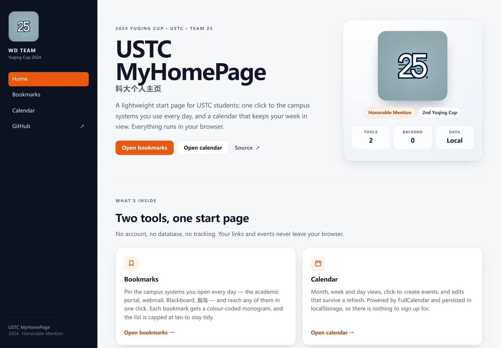
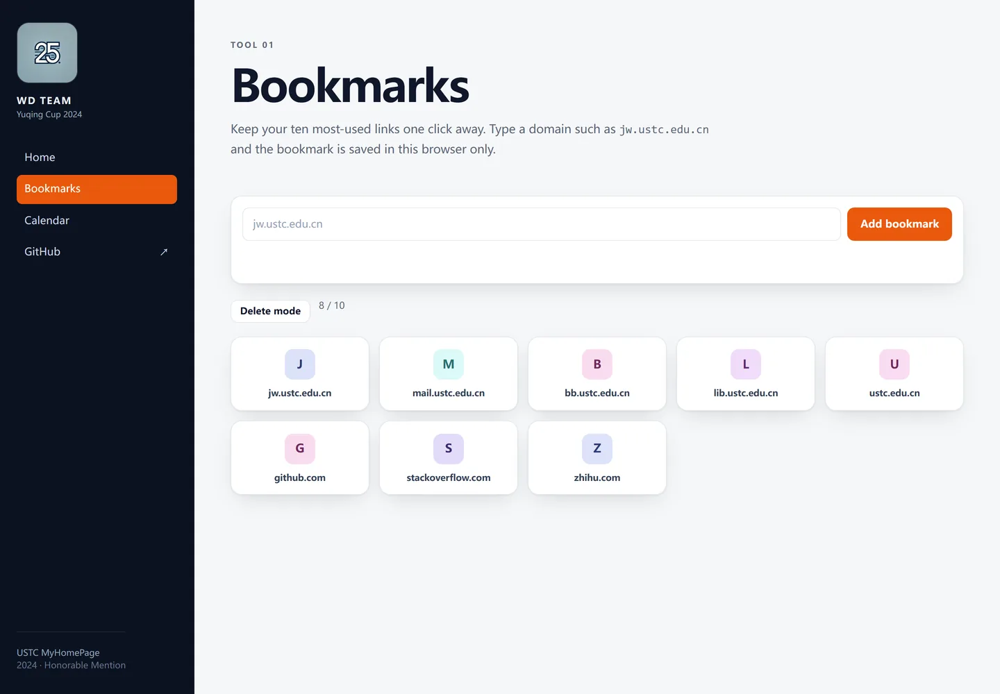
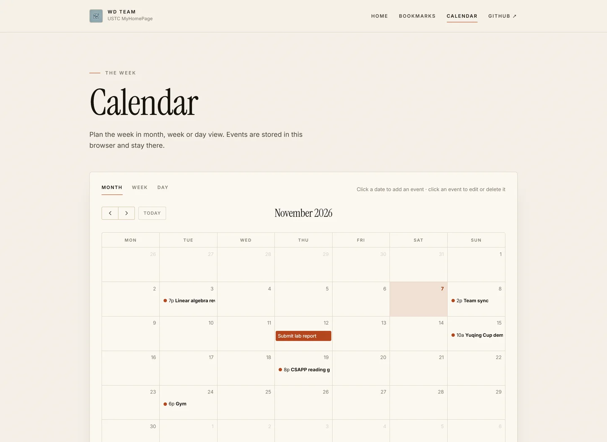

<div align="center">


# USTC MyHomePage · 科大个人主页

给 USTC 学生的轻量起始页：**校园书签导航** + **个人日程**，纯静态站点。
WD Team 参加 2024 年中国科大余庆杯的作品。

[](https://2024-ustc-yuqing-cup-wd-team.github.io/myhomepage/)
[](https://github.com/2024-ustc-yuqing-cup-wd-team/myhomepage/actions/workflows/ci.yml)
[](LICENSE)
[](LICENSE-docs)

[English](README.md) · [在线 demo](https://2024-ustc-yuqing-cup-wd-team.github.io/myhomepage/) · [部署仓库](https://github.com/2024-ustc-yuqing-cup-wd-team/orangepi-server)

</div>

## 这是什么

科大同学每天要在教务系统、邮箱、BB 平台、瀚海教学网、图书馆等一堆站点之间来回切换。
这个项目把最常用的入口收进一个起始页，再配上一个日历，让"今天要做什么"和"去哪里做"在同一个屏幕上解决。

全部数据只存在浏览器里：没有账号、没有数据库、没有统计；运行时**不请求任何第三方资源**，
所以断网的校园局域网也能正常使用。

| 首页 | 书签 |
| --- | --- |
|  |  |



## 功能

- **书签导航**：最多 10 个常用站点，用本地生成的彩色字母图标区分，不依赖 favicon 服务；
  点击新标签页打开。
- **日程管理**：基于 FullCalendar 的月 / 周 / 日视图，点选日期创建事件，支持编辑、删除，
  数据保存在 `localStorage`。
- **纯静态、可自托管**：没有构建步骤，也没有必须运行的后端；放到 Nginx、GitHub Pages
  或任何静态文件服务器上即可。
- **可选 API**：部署仓库里带一个极小的 Express 服务（`GET /api/health`），供 Orange Pi 部署使用。

## 本地运行

```bash
git clone https://github.com/2024-ustc-yuqing-cup-wd-team/myhomepage.git
cd myhomepage
python3 -m http.server 8000
# 浏览器打开 http://localhost:8000
```

没有安装依赖、没有构建步骤。仓库检查：

```bash
node scripts/check.mjs
```

## 目录结构

```text
myhomepage/
├── index.html / bookmarks.html / calendar.html
├── assets/{css,js,img,vendor}
├── docs/                  # 需求分析、概要设计、原始 PDF
├── scripts/check.mjs      # HTML / 链接 / JS 检查
├── .github/               # issue 模板、CI
├── LICENSE                # 代码 MIT
└── LICENSE-docs           # 文档 CC BY 4.0
```

## 部署

- **GitHub Pages**：<https://2024-ustc-yuqing-cup-wd-team.github.io/myhomepage/>
- **Orange Pi + Nginx**：见
  [`orangepi-server`](https://github.com/2024-ustc-yuqing-cup-wd-team/orangepi-server)，
  包含 nginx 配置、systemd 单元和一键引导脚本。

## 文档

| 文档 | Markdown | 原始 PDF |
| --- | --- | --- |
| 需求分析 | [requirements.md](docs/requirements.md) | [PDF](docs/archive/requirements-original.pdf) |
| 概要设计 | [design.md](docs/design.md) | [PDF](docs/archive/design-original.pdf) |

## 项目状态

这是 **2024 年比赛作品的存档仓库**。比赛结束后做过一次清理和补文档，目前不再继续开发新功能；
欢迎提 issue、修 bug 和改文档。

## 队伍

**WD Team**（队名取自两位创始成员姓氏首字母），2024 年余庆杯第 25 队，获 **Honorable Mention**。

## 许可证

- 代码：[MIT](LICENSE)
- 文档与图片：[CC BY 4.0](LICENSE-docs)
