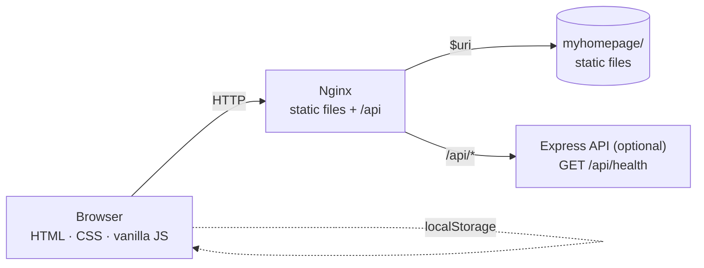

# Design Overview

**USTC MyHomePage** — 2024 USTC Yuqing Cup, Team 25

> Original submission: [`docs/archive/design-original.pdf`](archive/design-original.pdf)
>
> Sections 1–7 describe the design as it was submitted in 2024. Section 8
> documents the post-competition cleanup that produced the current code.

## 1. Introduction

The project is a small web application offering website navigation and schedule
management. The front end is plain HTML, CSS and JavaScript; the deployment uses
Nginx as a static host and reverse proxy on an Orange Pi, with a small Node.js
service for dynamic requests. User data is stored in the browser, so no database
is required.

## 2. Architecture

### 2.1 High-level design

The system follows a front-end / back-end split:

- **Front end:** HTML, CSS and JavaScript; responsive layout; DOM interaction
  and AJAX handled in the browser.
- **Back end:** a lightweight Node.js service handling optional requests.
- **Storage:** user data in browser cookies, avoiding a database entirely.

### 2.2 Original technology stack

| Layer | Choice |
| --- | --- |
| Front end | HTML5, CSS3, JavaScript, Bootstrap 4, jQuery |
| Back end | Node.js, Express |
| Server | Orange Pi, Nginx (reverse proxy) |

## 3. Feature design

### 3.1 Bookmark navigation

Users manage a list of frequently used URLs and open them with one click.

- **Manage:** add a bookmark by entering a URL; the URL and domain are stored.
- **Delete:** remove a saved bookmark; the stored entry is cleared.
- **Open:** clicking a bookmark opens the target site.

### 3.2 Schedule management

Users create, modify and delete personal events and switch between month, week
and day views.

- **Create:** add an event with a date, time and description.
- **Edit / move:** change an existing event.
- **Delete:** remove an event.
- **Views:** month, week and day.

## 4. Data storage

Data is serialised as JSON and stored in the browser. Each user's bookmarks and
events live in their own browser, so no server-side database is needed and no
data is shared between users.

## 5. Data flow and interaction

Front-end interaction is conventional DOM-driven:

1. the user types a URL and presses *Add* to save a bookmark;
2. clicking a bookmark icon opens the site in a new tab;
3. the user opens the calendar, creates an event and picks a view;
4. the browser persists everything locally for the next visit.

The original back end had no business endpoints; it served as a placeholder for
future APIs.

## 6. Deployment

- **Hardware:** an Orange Pi acting as the server.
- **Software:** Nginx for static files and reverse proxying, Node.js for the
  optional API.
- **Network:** the server runs on the campus LAN without a public IP or domain;
  users reach it by IP address.

## 7. Security and privacy

- Data stays in the user's browser and is never uploaded, so bookmarks and
  schedules are not exposed to other users.
- Because there is no server-side data store, there is no database to breach.

## 8. Post-competition refactor

The 2026 cleanup kept the product surface but modernised the implementation and
removed the issues that made the original repository hard to read.

### 8.1 What changed

| Area | 2024 submission | Current |
| --- | --- | --- |
| UI stack | Bootstrap 4 + jQuery + Semantic UI | Plain CSS, no framework |
| Page structure | One page with `<iframe>` embeds | Three real pages (`index`, `bookmarks`, `calendar`) |
| Storage | Cookies, hand-parsed | `localStorage`, versioned keys |
| Bookmark icons | Clearbit / Google favicon services | Local colour-coded monograms |
| Calendar | Vendored FullCalendar distribution with examples | Only `index.global.min.js` and its license |
| Back end | Hard-coded express demo + IMAP script with credentials | Optional Express service configured via environment variables |
| Docs | Two `.docx` + two `.pdf` files | Markdown in `docs/`, PDFs archived |
| Repository | `node_modules/` committed, GBK sources, no license | `.gitignore`, UTF-8, MIT + CC BY 4.0 |

### 8.2 Current architecture



The site has no build step and no runtime dependency on the API. The API exists
so the Orange Pi deployment has a place for server-side features and a health
check.

### 8.3 Repository layout

```text
myhomepage/
├── index.html            # landing page
├── bookmarks.html        # bookmark manager
├── calendar.html         # FullCalendar-based schedule
├── assets/
│   ├── css/              # base, bookmarks, calendar
│   ├── js/               # bookmarks.js, calendar.js
│   ├── img/              # logo, favicon, screenshots, social card
│   └── vendor/fullcalendar/
├── docs/                 # requirements, design, archived PDFs
├── scripts/check.mjs     # dependency-free repository checks
└── .github/              # issue templates and CI
```
